<div align="center">


# Tahfeez AI · تحفيظ

**Read, understand, memorize and recite the Holy Quran — with tajweed feedback from an AI that runs on your phone.**

**100% free · Works offline · No ads · No account · Your voice never leaves your phone**

[](LICENSE)
[](https://github.com/Omar-8/TahfeezAI/stargazers)
[](https://github.com/Omar-8/TahfeezAI/releases)


[](https://flutter.dev)


[**Website**](https://omar-8.github.io/TahfeezAI/) · [Features](#features) · [Tajweed](#tajweed-feedback) · [Screenshots](#screenshots) · [Build it](#build-and-run)

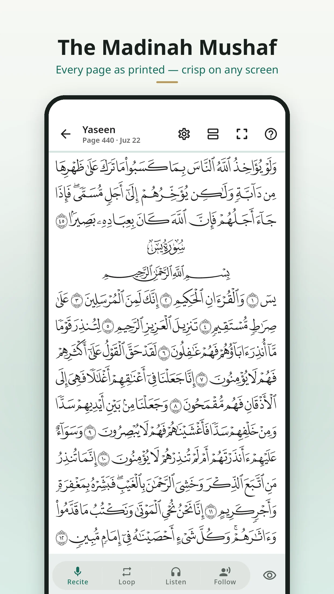 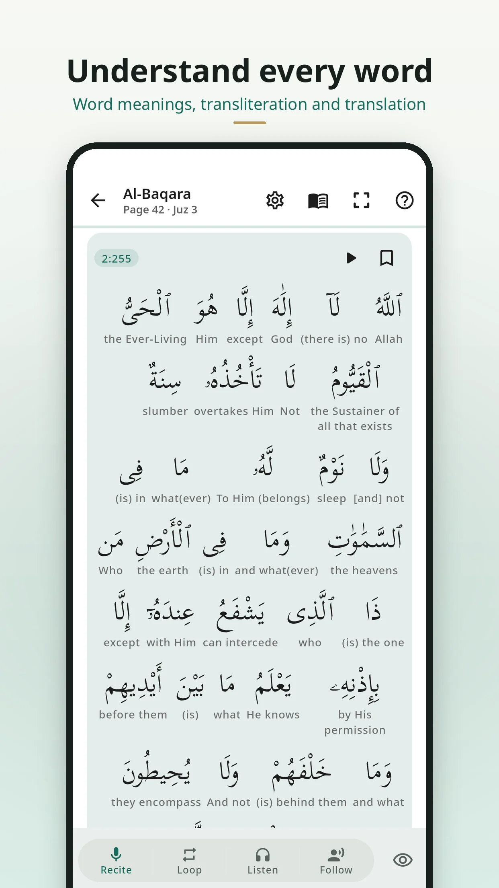 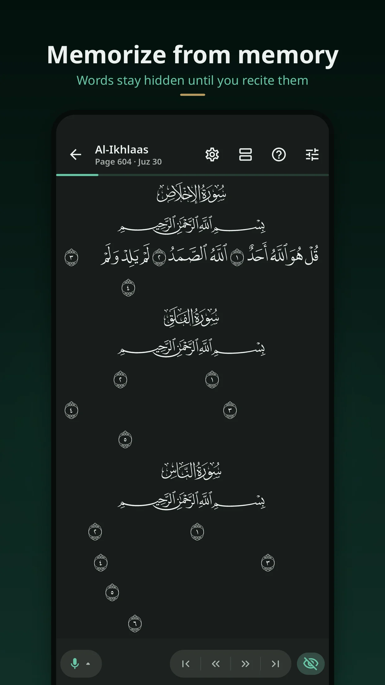 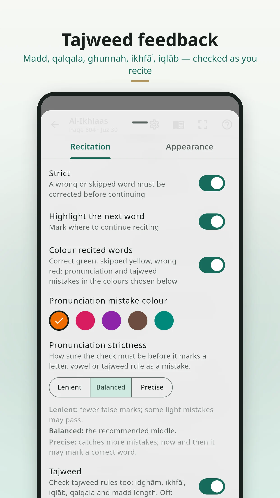

</div>

---

## Contents

- [Why Tahfeez AI](#why-tahfeez-ai)
- [Features](#features)
  - [Read](#read)
  - [Understand](#understand)
  - [Listen](#listen)
  - [Recite — with tajweed feedback](#tajweed-feedback)
  - [Memorize](#memorize)
  - [Make it yours](#make-it-yours)
- [Screenshots](#screenshots)
- [Privacy](#privacy)
- [How the AI works](#how-the-ai-works)
- [Download](#download)
- [Build and run](#build-and-run)
- [Project layout](#project-layout)
- [Contributing](#contributing)
- [Credits](#credits)
- [License](#license)

## Why Tahfeez AI

Memorizing the Quran is done by reciting — to a teacher who listens, catches the slip, and makes you say it again. Tahfeez AI brings a patient listener to your pocket: it follows you as you recite from memory, uncovers the words as you say them, and tells you when a word was wrong, skipped or mispronounced — including the **tajweed** of what you said.

It is a gift, not a product:

- **Free, forever** — no subscription, no in-app purchases, no ads.
- **Offline** — the Quran, translations, tafsir, word meanings, search, memorization and recitation checking all work without internet.
- **Private** — no account, no analytics, no tracking. The speech model runs **on your phone**; your recitation is never uploaded.
- **Open source** — GPL-3.0. Read the code, learn from it, improve it.

## Features

### Read

- **The Madinah Mushaf**, page by page, exactly as printed (King Fahd Complex layout), drawn natively and crisp on any screen size.
- **Ayah mode** — the same pages ayah by ayah, swiped page by page or in **one continuous scroll**.
- **Surah, juz, hizb and page** index; **Go to ayah**; **bookmarks**; **continue reading** from where you stopped; a **daily ayah**.
- **Search** the Arabic text (with or without diacritics) and the translations — offline.
- **Passage tints** that colour each rukūʿ, so a page's structure is visible at a glance.

### Understand

- **Word by word**: the meaning under every word, with **transliteration**.
- **Translations** in English, German, French, Turkish, Urdu and Indonesian.
- **Tafsir**: At-Tafsir Al-Muyassar (Arabic) and Al-Mukhtasar (English, French, Turkish, Indonesian).

### Listen

- **18 renowned reciters** — Mishary Alafasy, Al-Husary (murattal and mujawwad), Al-Minshawi, Abdul Basit, As-Sudais, Ash-Shuraym, Al-Muaiqly and more.
- The ayah being recited **lights up and is followed** page after page; playback speed; repeat an ayah or a range; download a reciter to listen offline.

### Tajweed feedback

Tahfeez AI listens to how you recite, not only to which words you say. With **Tajweed** on, the checking covers:

| Rule | What is checked |
|---|---|
| **Madd** | elongations held their full length (e.g. 4–6 counts where required) |
| **Qalqala** | the echo of ق ط ب ج د with sukūn or at a stop |
| **Ghunnah** — **ikhfāʾ**, **iqlāb**, **idghām** | the hidden nūn and mīm, nasalised as they should be |
| **Heavy and light letters** | ط/ت, ص/س, ض/د, ظ/ذ, ق/ك kept apart |
| **Throat letters** | ء ع ح ه خ غ said as themselves |
| **Shadda** | doubled letters held, single ones not doubled |
| **Vowels and case endings** | ḥarakāt, including the last vowel of a word |

Each word is coloured as you go — right, wrong, skipped or mispronounced — with a short explanation of the mistake and, if you like, a vibration the moment it happens.

> **An honest note:** the model is young. It will sometimes miss a mistake or flag a correct word. It is improving with every version — please [tell us](https://github.com/Omar-8/TahfeezAI/issues) when it gets something wrong.

### Memorize

- **Hide mode** — the page covered; words appear as you recite them correctly (or reveal them word by word, ayah by ayah).
- **Four ways to practise**: **Recite** from memory · **Loop** a range a number of times (strict mode pauses on a mistake) · **Listen** · **Follow along** — the reciter recites an ayah, then it's your turn.
- **A memorization plan** — today's new lesson and **spaced revision** of what you already know, each part's **strength** tracked from your recitations.
- **Progress map** of every page you have memorized; mark what you already know to start where you are.
- **Daily reminder**, sajdah reminders, an activity count of the ayahs heard and recited.

### Make it yours

- **App themes** — light, dark, warm, sepia and black, or follow your phone.
- **Reader themes** for the page — light, warm, sepia, dark, black.
- **4 Quran fonts** for Ayah mode (Scheherazade New, Amiri Quran, Noto Naskh Arabic, Lateef) and **3 Arabic fonts** for the app (Noto Kufi, Almarai, Tajawal).
- **Text size** from 80 % to 200 %, and the app follows your phone's own text size.
- **6 languages** — العربية · English · Deutsch · Français · Türkçe · اردو — with full right-to-left layout.
- Tested for phones from 280 px foldable cover screens to tablets, in portrait and landscape.

## Screenshots

| | | |
|:-:|:-:|:-:|
| 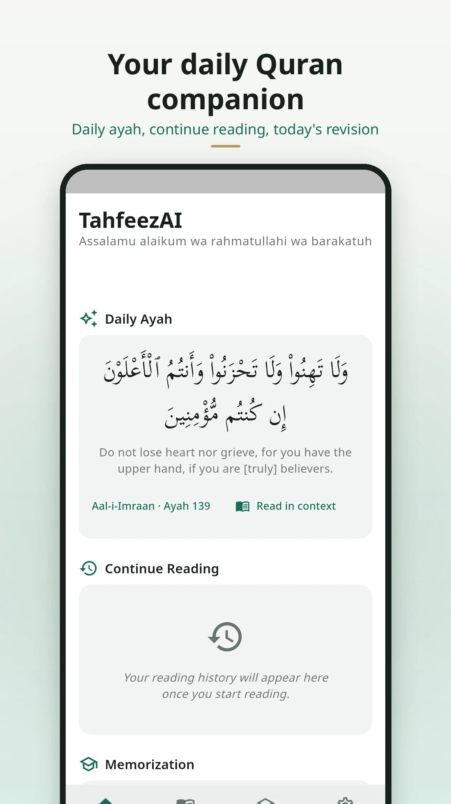 |  | 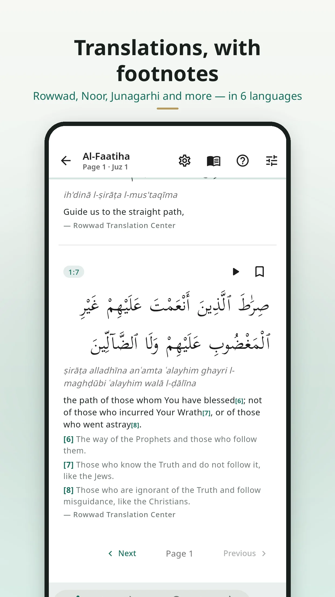 |
|  | 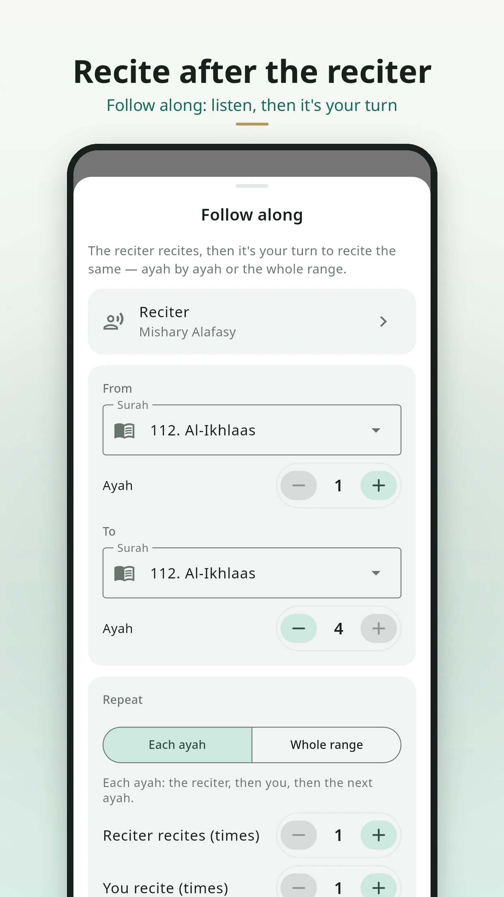 |  |
| 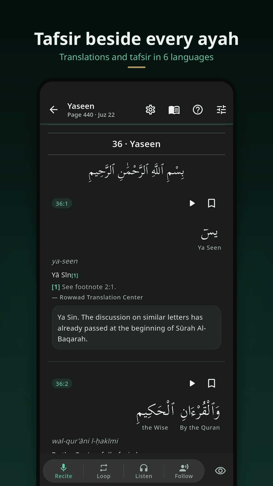 | 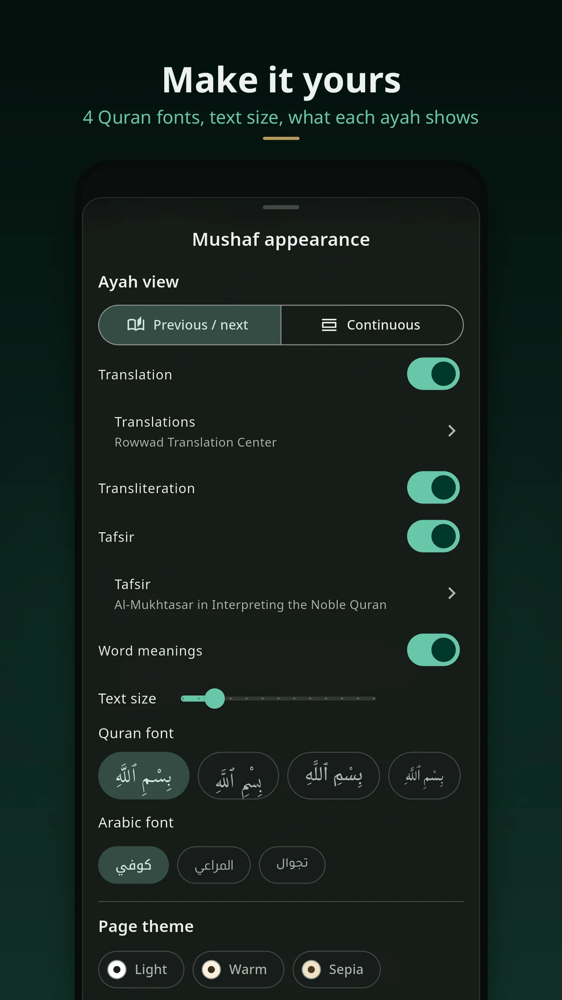 |  |
| 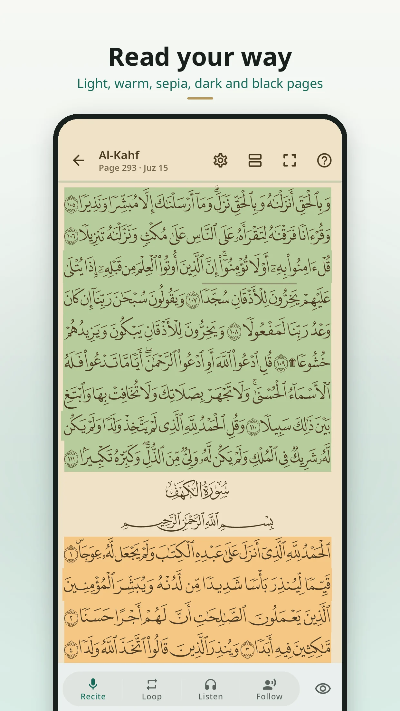 | 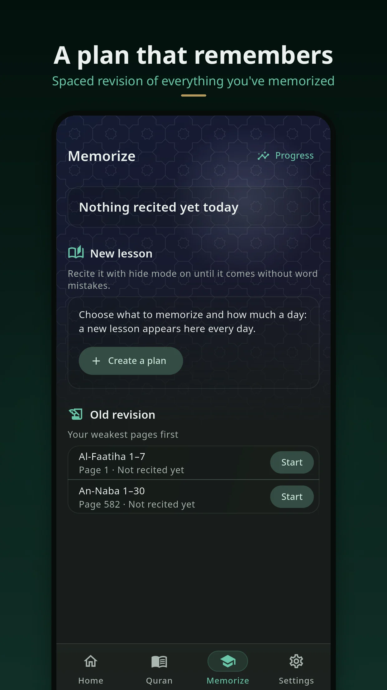 | 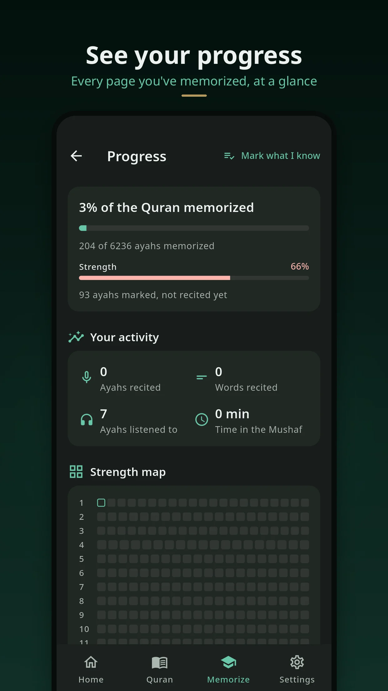 |
| 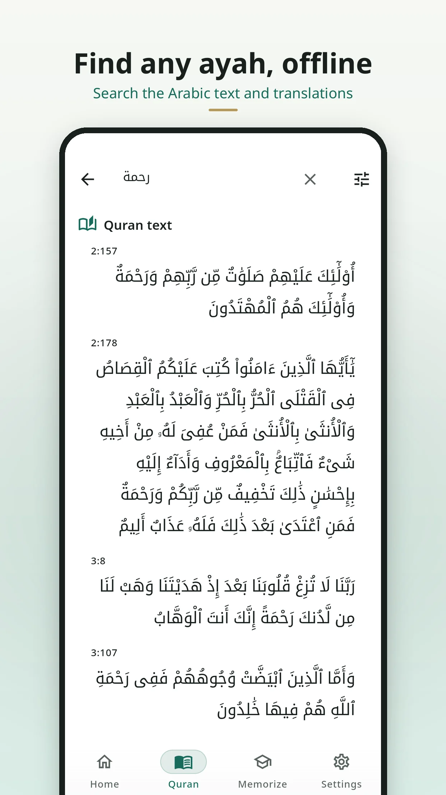 | 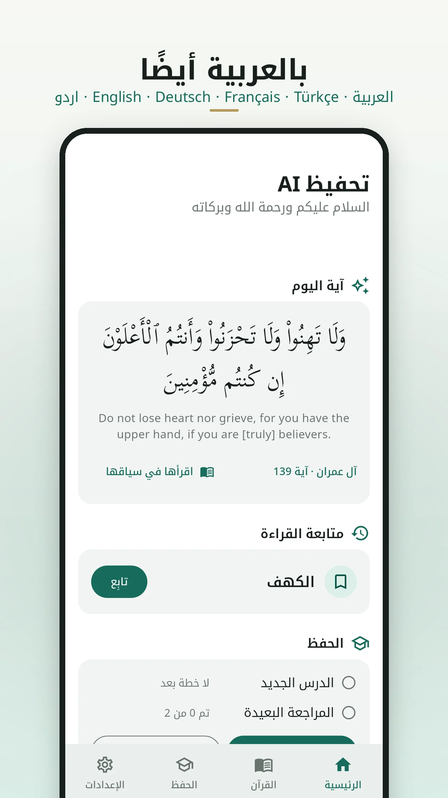 | 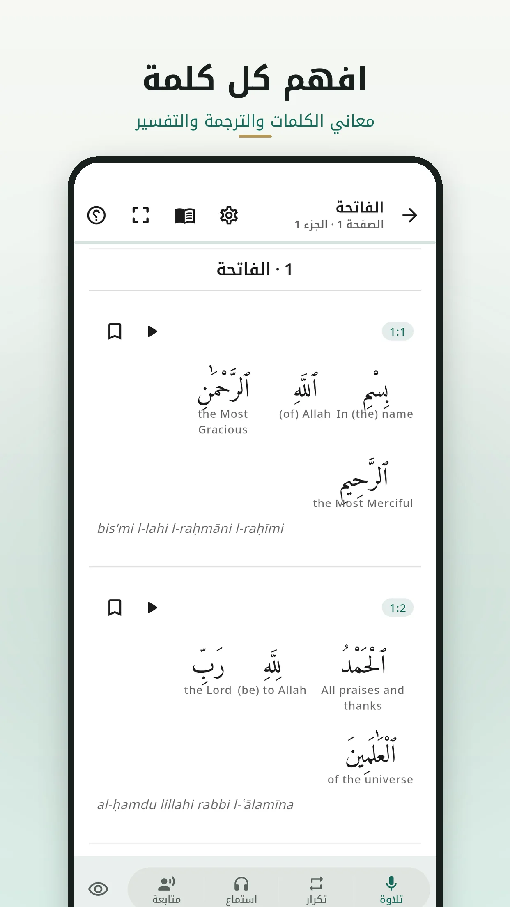 |

## Privacy

- **No account**, no sign-in, no advertising ID, **no analytics or crash-reporting SDK**.
- **Your recitation stays on your phone.** The audio is checked by the on-device model and discarded; release builds keep no recordings.
- Memorization progress, bookmarks and settings live only on your device. Export a backup file wherever you choose; *Settings → Your data → Reset all data* erases everything.
- The only network requests are the reciters' audio files (when you listen without having downloaded a reciter), and app updates and reviews through the store.

See the [privacy policy](docs/PRIVACY_POLICY.md) and the [Play data-safety answers](docs/PLAY_DATA_SAFETY.md).

## How the AI works

1. **Where are you?** As you recite, the app follows your position in the Quran from the words it hears — so you can start anywhere on the page.
2. **Was it right?** For each word, an **acoustic model** compares what you said with the expected Ḥafṣ pronunciation of that word: it aligns your audio to the word's expected sounds and scores every sound against its likely alternatives (a heavy letter against its light twin, a held madd against a short one…). A mistake is reported only on clear evidence; when it is unsure, it says nothing.
3. **On the phone.** The model (~93 MB, ONNX) is bundled in the app and runs with ONNX Runtime — on Android and iOS, offline. It is a streaming student model trained from the open [Muaalem](https://huggingface.co/obadx/muaalem-model-v3_2) model (MIT) on public recitation data; see [Credits](#credits).

## Download

| Android | iOS |
|:-:|:-:|
| *Google Play — coming soon* | *App Store — coming soon* |

Until then, builds are on the [releases page](https://github.com/Omar-8/TahfeezAI/releases), or [build it yourself](#build-and-run).

## Build and run

Tahfeez AI is a [Flutter](https://flutter.dev) app (Dart, Riverpod, go_router, Drift/SQLite). The Mushaf pages are drawn by the native [Quran Engine](https://github.com/quran-ws/quran-engine) (Rust, via `dart:ffi`), and the speech model runs with ONNX Runtime.

### Requirements

- **Flutter 3.47.3** (stable) and its Android toolchain; for iOS, a Mac with **Xcode 26** and CocoaPods.
- **Python 3** (data checks) and, for iOS only, **rustup** (to build the Mushaf engine for iOS; Android's is prebuilt).
- About 2 GB free for the Quran data and the model.

### 1. Code and generated sources

```sh
git clone https://github.com/Omar-8/TahfeezAI.git
cd TahfeezAI
flutter pub get
dart run build_runner build --delete-conflicting-outputs   # Drift, Freezed, Riverpod
flutter gen-l10n                                           # the 6 languages
```

### 2. Quran data (not in git: rebuilt from its sources, checksums verified)

```sh
bash tool/quran_engine/fetch_page_data.sh --all     # the Mushaf pages (Quran Engine v0.3.0)
dart run tool/quran_data/fetch_sources.dart         # text, translations, tafsir, layout sources
dart run tool/quran_data/build_production_data.dart # the app's bundled data
```

### 3. The speech model

Download `quran_acoustic.onnx` and `quran_acoustic.json` from the [`model-v3.5` release](https://github.com/Omar-8/TahfeezAI/releases/tag/model-v3.5) into `assets/models/`:

```sh
gh release download model-v3.5 --repo Omar-8/TahfeezAI --dir assets/models
```

### 4. Run

```sh
flutter run                        # Android: a phone with USB debugging, or an emulator
flutter build apk --release        # an APK (signing: android/key.properties.example)
```

**iOS** (on a Mac):

```sh
bash third_party/qvp_flutter/scripts/build-engine-ios.sh   # the Mushaf engine for iOS
cd ios && pod install && cd ..
flutter run                                                 # a simulator or an iPhone
```

More detail: [docs/IOS.md](docs/IOS.md). The `iOS` GitHub workflow builds all of this on a Mac runner.

### 5. Tests

```sh
flutter analyze
flutter test                                  # ~1,000 tests
tool/test_responsive_all.sh                   # every screen × 18 sizes × 6 languages × text sizes (~1 h)
tool/test_crawl.sh                            # every control on every screen, tapped
flutter drive --driver=test_driver/integration_test.dart \
  --target=integration_test/device_qa_test.dart -d <device>   # the walk-through on a real device
```

## Project layout

```
lib/
  app/            startup, the shell, routing
  features/       home, quran index, mushaf (reader, Ayah mode), listen,
                  recitation (Recite / Loop / Follow along), memorize, search,
                  bookmarks, settings, guide
  quran/          the Quran data: repositories, Drift databases, translations, tafsir
  ai/acoustic/    the pronunciation checker (alignment and scoring)
  memorization/   plans, attempts, spaced revision
packages/         platform pieces (iOS)
third_party/      qvp_flutter — the Quran Engine binding
tool/             data builders, the acoustic model tools, test runners
docs/             architecture, data provenance, licences, privacy
site/             the website (GitHub Pages)
```

## Contributing

Bug reports, ideas and pull requests are very welcome — especially:

- **Recitation mistakes the checker missed or wrongly flagged** (say the surah and ayah, and what you said).
- Translations of the interface into more languages.
- Quran-data corrections — but note that **canonical Quran text is never edited by hand**; it comes from verified sources (see [docs/QURAN_DATA_PROVENANCE.md](docs/QURAN_DATA_PROVENANCE.md)).

Please run `flutter analyze` and `flutter test` before a pull request.

## Credits

Tahfeez AI stands on the generous work of others. Full details — versions, checksums and licence terms — are in [docs/THIRD_PARTY_RESOURCES.md](docs/THIRD_PARTY_RESOURCES.md) and on the app's Credits page.

- **Quran text** — [Tanzil Project](https://tanzil.net) (Uthmani, verbatim).
- **The Mushaf** — Mus'haf al-Madinah © [King Fahd Glorious Qur'an Printing Complex](https://qurancomplex.gov.sa); page data from [Quran Engine](https://github.com/quran-ws/quran-engine) by Quran.ws (CC BY 4.0); layout and word data provided by [QUL — Quranic Universal Library](https://qul.tarteel.ai) (Tarteel).
- **Translations and tafsir** — [QuranEnc.com](https://quranenc.com): Rowwad Translation Center, Noor International Center, the Indonesian Ministry of Religious Affairs, Muhammad Junagarhi, At-Tafsir Al-Muyassar, Al-Mukhtasar.
- **Word meanings and transliteration** — quran.com data.
- **Recitations** — the reciters, served by [islamic.network](https://alquran.cloud) and [quran.com](https://quran.com).
- **Speech model** — trained from [obadx/muaalem-model-v3_2](https://huggingface.co/obadx/muaalem-model-v3_2) (MIT) with the [quran-transcript](https://github.com/obadx/quran-transcript) phonetizer (MIT); training audio from public recitation datasets (Tarteel, everyayah.com, RetaSy and others) — credited with thanks; where a source states no licence, its use is listed openly in the resources document.
- **Fonts** — Scheherazade New and Lateef (SIL), Amiri Quran (the Amiri Project), Noto Sans, Noto Naskh Arabic and Noto Kufi Arabic (Google), Almarai, Tajawal — all SIL Open Font License.
- Built with Flutter, Riverpod, go_router, Drift, just_audio and ONNX Runtime.

May Allah accept it from everyone who contributed.

## License

Tahfeez AI's source code is licensed under the **GNU General Public License v3.0** — see [LICENSE](LICENSE). You may use, study, share and change it; apps built from it must stay open source under the same licence.

The bundled Quran text, Mushaf data, translations, tafsir, fonts, recitations and model keep their own licences and terms, listed in [docs/THIRD_PARTY_RESOURCES.md](docs/THIRD_PARTY_RESOURCES.md).
